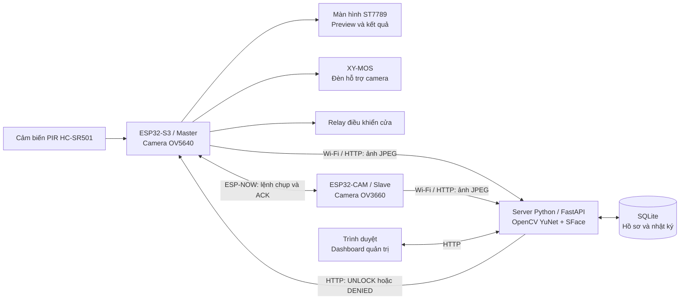

# ESP32-S3 Smart Home Face Recognition

**Hệ thống kiểm soát ra vào bằng nhận diện khuôn mặt với ESP32-S3, ESP32-CAM và server Python.**

Dự án kết hợp firmware nhúng, giao tiếp không dây và thị giác máy tính để thực hiện một luồng hoàn chỉnh: phát hiện chuyển động → chụp ảnh từ hai góc → xác thực khuôn mặt → điều khiển relay → lưu kết quả trên dashboard.

ESP32-S3 là bộ điều khiển chính, ESP32-CAM bổ sung góc chụp thứ hai. Việc phát hiện và đối chiếu khuôn mặt chạy trên **server Python**, còn các bo ESP32 đảm nhiệm thu ảnh, giao tiếp và điều khiển phần cứng.

[Kiến trúc](#kiến-trúc-hệ-thống) · [Chức năng](#chức-năng-chính) · [Đấu nối](#đấu-nối-phần-cứng) · [Cách lấy IP](#31-lấy-ipv4-của-máy-chạy-server) · [Cách chạy](#hướng-dẫn-chạy) · [Kiểm thử](#kiểm-thử)

## Mục tiêu dự án

- Xây dựng mô hình kiểm soát cửa bằng khuôn mặt, có màn hình hướng dẫn tại thiết bị và giao diện quản trị trên trình duyệt.
- Kết hợp hai camera để bổ sung góc quan sát; Master vẫn có thể xác thực khi Slave không tham gia phiên chụp.
- Tách firmware, xử lý nhận diện và quản lý dữ liệu thành các phần có thể kiểm thử, theo dõi và mở rộng độc lập.

## Kiến trúc hệ thống



ESP-NOW truyền lệnh điều khiển và trạng thái giữa hai bo. Ảnh được từng bo gửi trực tiếp lên server qua Wi-Fi/HTTP. Master là thiết bị duy nhất điều khiển relay.

### Vai trò các thành phần

| Thành phần | Chức năng |
| --- | --- |
| **ESP32-S3 Master** | Đọc PIR, hiển thị preview và đếm ngược trên ST7789, điều khiển đèn qua XY-MOS, tạo phiên chụp, gửi lệnh cho Slave, tải ảnh lên server và điều khiển relay theo kết quả. |
| **ESP32-CAM Slave** | Nhận lệnh ESP-NOW, phản hồi trạng thái camera, chụp ảnh OV3660 và gửi ảnh kèm cùng mã phiên lên server. Có xử lý thử lại khởi tạo camera và phương án chuyển sang JPEG bằng phần mềm. |
| **Server Python** | Phát hiện khuôn mặt bằng YuNet, trích xuất đặc trưng bằng SFace, kiểm tra chất lượng ảnh, đối chiếu nhiều mẫu và tổng hợp kết quả theo phiên. |
| **Dashboard** | Đăng nhập quản trị, quản lý người dùng và ảnh mẫu, xem kết quả nhận diện, ảnh của phiên và nhật ký kết nối thiết bị. |

## Chức năng chính

- **Luồng nhận diện tại cửa:** PIR kích hoạt màn hình, preview đếm ngược 20 giây; đèn hỗ trợ bật trong 5 giây cuối trước khi chụp.
- **Xác thực nhiều khung hình:** mỗi camera chụp tối đa 3 ảnh; cấu hình hiện tại yêu cầu ít nhất 2 ảnh đạt và nhất quán về cùng một người trong một camera.
- **Ưu tiên Master:** firmware sử dụng chế độ `master_primary`. Master xác thực đạt có thể hoàn tất phiên mà không chờ Slave; Slave có thể cung cấp kết quả dự phòng nếu Master không đạt hoặc không chụp được, trong giới hạn thời gian của phiên.
- **Điều khiển relay có kiểm tra phiên:** chỉ mở khi có kết quả cuối hợp lệ; mã phiên giúp bỏ qua phản hồi cũ và tránh kích hoạt lặp cho cùng phiên. Relay được kích hoạt trong khoảng 3 giây.
- **Quản lý mẫu khuôn mặt:** đăng ký ảnh chính diện, nghiêng nhẹ, có và không có khẩu trang; tối đa 20 mẫu mỗi hồ sơ theo cấu hình hiện tại.
- **Theo dõi hệ thống:** heartbeat chạy ở task riêng; dashboard cập nhật dữ liệu mỗi 3 giây, hiển thị trạng thái kết nối và nhật ký nhận diện.
- **Quản trị có xác thực:** mật khẩu được băm bằng PBKDF2-HMAC-SHA256, sử dụng session đăng nhập và CSRF token cho các thao tác quản lý người dùng.

Các kiểm tra chất lượng ảnh gồm kích thước khuôn mặt, độ sáng, độ nét và góc chụp. HOG vùng mắt hiện được dùng để chẩn đoán bổ sung, không tự quyết định cấp quyền.

## Công nghệ sử dụng

| Nhóm | Công nghệ |
| --- | --- |
| Firmware | C, ESP-IDF 5.5, FreeRTOS, GPIO, SPI, PSRAM |
| Giao tiếp | ESP-NOW, Wi-Fi 2.4 GHz, HTTP, JSON |
| Camera và hiển thị | `esp32-camera`, JPEG, OV5640, OV3660, ST7789 240 × 240 |
| Backend | Python 3.11, FastAPI, Uvicorn |
| Thị giác máy tính | OpenCV, YuNet, SFace, NumPy, model ONNX |
| Giao diện | Jinja2, HTML, CSS, JavaScript |
| Dữ liệu và kiểm thử | SQLite, Python `unittest`, kiểm thử trình duyệt bằng Chrome headless |

## Đấu nối phần cứng

Các bảng dưới đây đối chiếu trực tiếp với firmware hiện tại. **GPIO là số chân logic của từng bo**, không phải vị trí chân trên đầu cắm hoặc số chân cáp FPC. Master và Slave truyền dữ liệu không dây, không cần nối dây TX/RX giữa hai bo.

GPIO dùng tín hiệu logic 3.3 V; không đưa tín hiệu 5 V vào GPIO. Điện áp cấp nguồn của bo/module phải theo nhãn và sơ đồ của đúng phiên bản phần cứng. Tham khảo giới hạn điện áp trong [datasheet ESP32-S3 của Espressif](https://documentation.espressif.com/esp32_s3_datasheet_en.pdf).

### Camera OV5640 và OV3660

Camera cắm qua đầu FPC của bo/module tương ứng. Bảng này mô tả **ánh xạ tín hiệu camera trong code**, không phải thứ tự chân FPC để tự đấu một cảm biến rời. Nguồn và GND camera đi theo thiết kế module/đầu cắm; firmware không xác định điện áp cấp cho camera.

| Tín hiệu camera | ESP32-S3 Master / OV5640 | ESP32-CAM Slave / OV3660 |
| --- | --- | --- |
| D0 / Y2 | GPIO11 | GPIO5 |
| D1 / Y3 | GPIO9 | GPIO18 |
| D2 / Y4 | GPIO8 | GPIO19 |
| D3 / Y5 | GPIO10 | GPIO21 |
| D4 / Y6 | GPIO12 | GPIO36 |
| D5 / Y7 | GPIO18 | GPIO39 |
| D6 / Y8 | GPIO17 | GPIO34 |
| D7 / Y9 | GPIO16 | GPIO35 |
| XCLK | GPIO15 | GPIO0 |
| PCLK | GPIO13 | GPIO22 |
| VSYNC | GPIO6 | GPIO25 |
| HREF | GPIO7 | GPIO23 |
| SIOD / SDA của SCCB | GPIO4 | GPIO26 |
| SIOC / SCL của SCCB | GPIO5 | GPIO27 |
| PWDN | Không điều khiển bằng GPIO (`-1`) | GPIO32 |
| RESET | Không điều khiển bằng GPIO (`-1`) | Không điều khiển bằng GPIO (`-1`) |

Nếu đổi bo hoặc đổi cách nối camera, sửa các macro `*_GPIO_NUM` trong [Master main.c](master_esp32s3/main/main.c) hoặc [Slave main.c](slave_esp32cam/main/main.c), rồi build/nạp lại bo tương ứng. Giá trị `-1` chỉ có nghĩa driver không điều khiển chân đó; mạch camera vẫn phải có trạng thái nguồn/reset đúng theo thiết kế module.

### Màn hình ST7789 240 × 240 nối với Master

| Chân trên module ST7789 | Nối tới ESP32-S3 | Chức năng |
| --- | --- | --- |
| SCL / SCK / CLK | GPIO39 | Xung SPI; chân SCL ở đây là clock SPI, không phải I²C |
| SDA / MOSI / DIN | GPIO38 | Dữ liệu SPI từ Master tới màn hình |
| CS | GPIO40 | Chọn màn hình |
| DC / A0 | GPIO41 | Chọn dữ liệu hoặc lệnh |
| RES / RST | GPIO42 | Reset màn hình |
| BL / BLK, ngõ điều khiển đèn nền | GPIO2 | HIGH bật đèn nền, LOW tắt |
| GND | GND của Master | Mass chung |
| VCC | Nguồn đúng định mức của module ST7789 | Không suy ra điện áp VCC chỉ từ tên ST7789 |

Driver hiện tại không sử dụng MISO. Nếu BL/BLK là chân cấp dòng trực tiếp cho LED thay vì ngõ điều khiển, cần mạch đệm/transistor phù hợp; GPIO2 chỉ đảm nhiệm tín hiệu điều khiển. Các chân được khai báo trong [display_st7789.h](master_esp32s3/main/display_st7789.h).

### PIR, relay và XY-MOS nối với Master

| Linh kiện / chân | Nối tới | Ghi chú |
| --- | --- | --- |
| PIR HC-SR501 / OUT | GPIO14 | Firmware đọc HIGH khi phát hiện chuyển động; ngõ OUT phải tương thích 3.3 V |
| PIR / VCC | Nguồn theo định mức module PIR | Xác định VCC theo nhãn, không theo thứ tự chân nhìn từ một ảnh module khác |
| PIR / GND | GND của Master | Mass chung với tín hiệu OUT |
| Module relay / IN | GPIO1 | Firmware hiện tại dùng HIGH để kích hoạt, LOW để nhả |
| Module relay / VCC | Nguồn theo định mức module relay | Dùng module nhận tín hiệu điều khiển 3.3 V, hoặc có mạch đệm phù hợp |
| Module relay / GND điều khiển | GND của Master | Không nối cuộn relay trực tiếp vào GPIO |
| XY-MOS / TRIG hoặc PWM | GPIO21 | HIGH bật hai đèn, LOW tắt; kiểm tra GPIO21 có được đưa ra ngoài trên bo thực tế |
| XY-MOS / GND tín hiệu | GND của Master | Chung mass với nguồn điều khiển/tải của module không cách ly |

**Hai đèn 5 V qua XY-MOS:** dùng nguồn ngoài đủ dòng cho hai đèn. Nối cực dương/âm nguồn vào cặp **nguồn vào** của XY-MOS (`DC+`, `DC-` hoặc ký hiệu tương đương); nối hai cực dương đèn chung vào **OUT+**, hai cực âm đèn chung vào **OUT-**. Như vậy hai đèn mắc song song ở đầu ra module. Đối chiếu đúng ký hiệu trên phiên bản XY-MOS đang dùng; không cấp dòng cho hai đèn từ GPIO hoặc chân 3.3 V của ESP32.

GPIO21 chỉ điều khiển ngõ TRIG/PWM tương thích mức 3.3 V. Cấu hình nằm trong [camera_light.h](master_esp32s3/main/camera_light.h). Với relay, chân **COM/NO/NC** thuộc mạch nguồn của khóa/tải; chọn NO hoặc NC theo loại khóa, tách biệt với chân tín hiệu IN.

### USB-UART để nạp ESP32-CAM Slave

Với bo AI-Thinker có chân nguồn 5V, sử dụng nguồn 5 V phù hợp và bộ USB-UART có **TX/RX mức logic 3.3 V**. Nguồn 5 V cấp vào chân 5V của bo, không cấp vào chân UART hay chân 3V3. Xem sơ đồ đầu cắm trong [datasheet ESP32-CAM của Ai-Thinker](https://datasheet.lcsc.com/lcsc/Ai-Thinker-ESP32-CAM_C277946.pdf).

| Phía nguồn / USB-UART | Nối tới ESP32-CAM Slave |
| --- | --- |
| Nguồn 5 V / cực dương | Chân 5V của bo |
| GND nguồn và GND USB-UART | GND của bo |
| TXD, tín hiệu 3.3 V | U0R / RX0 / GPIO3 |
| RXD, tín hiệu 3.3 V | U0T / TX0 / GPIO1 |
| GND, chỉ khi vào chế độ nạp | GPIO0 |

Khi nạp: nối GPIO0–GND rồi reset/cấp nguồn để vào bootloader. Sau khi nạp xong: **bỏ nối GPIO0–GND rồi reset lại**. GPIO0 còn là XCLK của camera Slave khi ứng dụng chạy. Nếu dùng ESP32-CAM-MB có mạch USB-UART tích hợp, thực hiện chế độ nạp/reset theo bo đó.

## Cấu trúc mã nguồn

```text
.
├── master_esp32s3/           # Firmware Master: camera, TFT, PIR, relay, đèn
├── slave_esp32cam/           # Firmware Slave: camera và ESP-NOW
├── cloud_server/
│   ├── app.py               # API, phiên chụp và dashboard
│   ├── face_ai.py           # YuNet/SFace và kiểm tra chất lượng ảnh
│   ├── recognition.py       # Đối chiếu danh tính, tổng hợp nhiều khung hình
│   ├── db.py                # Khởi tạo và cập nhật cấu trúc SQLite
│   ├── models/              # Hai model ONNX dùng cho nhận diện
│   ├── templates/           # Trang đăng nhập và dashboard
│   ├── static/              # CSS và JavaScript
│   ├── tests/               # Kiểm thử API, nhận diện và giao diện
│   └── .env.example         # Mẫu cấu hình server
├── project_network.h        # Cấu hình mạng chung và giá trị mẫu
├── camera_quality.h         # Thông số camera dùng chung
├── capture_protocol.h       # Giao thức điều khiển ESP-NOW dùng chung
└── tools/                   # Công cụ ghi log UART của Master
```

## Hướng dẫn chạy

### 1. Chuẩn bị

- ESP32-S3 với camera OV5640, màn hình ST7789, PIR HC-SR501, relay và cụm đèn qua XY-MOS. Cấu hình Master hiện tại dùng flash 16 MB và PSRAM Octal 8 MB.
- ESP32-CAM có PSRAM, sử dụng camera OV3660 và sơ đồ chân AI-Thinker như trong firmware. Cấu hình flash hiện tại là 4 MB.
- Máy tính chạy server Python 3.11 và môi trường ESP-IDF 5.5 để build/nạp firmware.
- Hai bo kết nối cùng mạng Wi-Fi 2.4 GHz; server có địa chỉ LAN mà cả hai bo truy cập được qua cổng 8000.

Đấu các linh kiện theo mục [Đấu nối phần cứng](#đấu-nối-phần-cứng) và kiểm tra lại sơ đồ của đúng bo/module trước khi nạp.

Các lệnh dưới đây dùng **PowerShell trên Windows**.

```powershell
git clone https://github.com/hoducduy243-create/ESP32-S3-Smart-Home-Face-Recognition.git
cd ESP32-S3-Smart-Home-Face-Recognition
```

### 2. Cấu hình và chạy server

Từ thư mục gốc của dự án:

```powershell
cd cloud_server
python -m venv .venv
.\.venv\Scripts\python.exe -m pip install -r requirements.txt
Copy-Item .env.example .env
```

Tạo mật khẩu băm và khóa session bằng hai lệnh sau:

```powershell
.\.venv\Scripts\python.exe -c "from getpass import getpass; from security import hash_password; print(hash_password(getpass('Admin password: ')))"
.\.venv\Scripts\python.exe -c "import secrets; print(secrets.token_hex(32))"
```

Điền kết quả vào `cloud_server/.env`:

```dotenv
ADMIN_USERNAME=admin
ADMIN_PASSWORD_HASH=<kết quả lệnh băm mật khẩu>
SESSION_SECRET_KEY=<kết quả lệnh tạo khóa session>
```

Trước khi đăng ký người dùng trên database mới, đặt `identity_aliases` thành `{}` trong [recognition_config.json](cloud_server/recognition_config.json). Mapping này sử dụng ID hồ sơ cụ thể, chỉ cần khi đã xác nhận hai hồ sơ thuộc cùng một người.

```powershell
.\.venv\Scripts\python.exe app.py
```

- Mở dashboard tại `http://localhost:8000` và đăng nhập bằng tài khoản vừa cấu hình.
- Kiểm tra server qua `http://localhost:8000/health`; xem API tại `http://localhost:8000/docs`.
- Server lắng nghe tại `0.0.0.0:8000`, tự khởi tạo database và các thư mục dữ liệu. Hai model ONNX cần thiết đã nằm trong `cloud_server/models/`.

### 3. Cấu hình mạng cho hai bo

#### 3.1. Lấy IPv4 của máy chạy server

**IP này lấy từ máy tính đang chạy `cloud_server/app.py`.** Trong mạng gia đình thông thường, router cấp địa chỉ này qua DHCP. GitHub chỉ lưu mã nguồn và không cấp địa chỉ server cho hai bo.

Trên máy chạy server, mở **PowerShell hoặc Command Prompt** và chạy:

```powershell
ipconfig
```

Tìm adapter đang nối vào cùng mạng LAN với hai bo: **Wireless LAN adapter Wi-Fi** nếu dùng Wi-Fi, hoặc **Ethernet adapter Ethernet** nếu máy tính nối dây mạng. Lấy giá trị **IPv4 Address** trong adapter đó. Lệnh `ipconfig` hiển thị IPv4 và gateway của các adapter theo [hướng dẫn Microsoft](https://learn.microsoft.com/en-us/windows-server/administration/windows-commands/ipconfig).

Ví dụ kết quả minh họa:

```text
Wireless LAN adapter Wi-Fi:
   IPv4 Address. . . . . . . . . . . : 192.168.1.50
   Subnet Mask . . . . . . . . . . . : 255.255.255.0
   Default Gateway . . . . . . . . . : 192.168.1.1
```

Trong ví dụ này, điền **`192.168.1.50`** vào firmware. Không lấy `192.168.1.1` ở dòng Default Gateway vì đó là router. Không chọn địa chỉ VPN/VirtualBox/VMware/WSL, adapter đã ngắt kết nối hoặc địa chỉ tự gán `169.254.x.x`.

#### 3.2. Điền IP vào đúng tệp

Từ **thư mục gốc của dự án** sau khi clone trên máy của bạn, tạo/mở tệp bằng:

```powershell
notepad .\project_network.local.h
```

Tệp nằm ngang hàng với `project_network.h`, `master_esp32s3/` và `slave_esp32cam/`; không đặt trong `cloud_server/` hay thư mục `main/`. Lưu đúng tên **`project_network.local.h`**, không có đuôi `.txt`.

Điền thông tin của môi trường đang chạy:

```c
#pragma once

#define WIFI_SSID "YOUR_2_4_GHZ_WIFI"
#define WIFI_PASS "YOUR_WIFI_PASSWORD"
#define PROJECT_SERVER_HOST "192.168.1.50"
#define PROJECT_SERVER_PORT 8000
```

| Giá trị | Điền thông tin gì? |
| --- | --- |
| `WIFI_SSID` | Tên Wi-Fi 2.4 GHz mà hai bo sẽ kết nối |
| `WIFI_PASS` | Mật khẩu của Wi-Fi đó |
| `PROJECT_SERVER_HOST` | IPv4 vừa đọc trên máy chạy server; `192.168.1.50` chỉ là ví dụ |
| `PROJECT_SERVER_PORT` | Giữ `8000` để khớp cổng đang cấu hình trong `cloud_server/app.py` |

Chỉ điền địa chỉ IP vào `PROJECT_SERVER_HOST`, **không thêm `http://`, `:8000` hay đường dẫn**. Không điền `localhost`, `127.0.0.1` hoặc `0.0.0.0`; hai bo cần địa chỉ LAN cụ thể để gọi server. Server dùng `0.0.0.0` để lắng nghe trên các giao diện mạng, không dùng giá trị đó làm địa chỉ đích.

Hai firmware cùng đọc tệp này thông qua `project_network.h`, nên chỉ cần cấu hình mạng chung một lần. Giữ `project_network.h` làm bộ nạp cấu hình; mật khẩu thực tế đặt trong `project_network.local.h`, tệp đã được Git bỏ qua.

#### 3.3. Kiểm tra kết nối và dùng trên máy khác

Sau khi chạy server theo bước 2:

1. Trên chính máy chạy server, mở `http://localhost:8000/health`.
2. Trên điện thoại hoặc máy tính **khác cùng mạng LAN**, mở `http://192.168.1.50:8000/health`, thay IP ví dụ bằng IPv4 vừa lấy. Nếu truy cập được, thiết bị khác trong LAN đã gọi được server.
3. Nếu bước 1 được nhưng bước 2 không được, kiểm tra đúng IP/adapter, cho phép Python hoặc TCP 8000 qua Windows Firewall trên mạng Private, và tránh Wi-Fi khách có tính năng chặn truy cập giữa các thiết bị. Không cần tắt toàn bộ firewall.
4. Build và nạp lại **cả Master lẫn Slave** theo bước 4 để hai bo nhận cấu hình mới. Sửa tệp trên máy tính không tự cập nhật firmware đã nạp trên bo.

Khi chuyển dự án sang máy khác: người chạy tự cài server, cấu hình `cloud_server/.env`, chạy `ipconfig` trên **máy server mới**, tạo `project_network.local.h` với thông tin Wi-Fi/IP của họ, rồi build/nạp lại hai bo. Không sao chép nguyên IP ví dụ hoặc IP của máy cũ. Nếu máy mới chỉ mở dashboard và server vẫn chạy trên máy cũ, tiếp tục dùng IP của máy cũ.

Master và Slave được phép có **IP riêng khác nhau**; không cần điền IP của hai bo vào tệp trên. Cả hai phải truy cập được server, đồng thời cùng kênh Wi-Fi để ESP-NOW liên lạc được. Khi router đổi IP của máy server, đọc lại IP và cập nhật/nạp lại; có thể cấu hình DHCP reservation trên router để giữ IP server ổn định. Với thiết bị ở mạng khác, địa chỉ LAN này cần một giải pháp kết nối riêng như VPN.

### 4. Build và nạp firmware

Mở **terminal đã nạp môi trường ESP-IDF 5.5** tại thư mục gốc. Thay `COM3` và `COM4` bằng cổng thực tế của từng bo.

**Master ESP32-S3:**

```powershell
cd master_esp32s3
idf.py set-target esp32s3
idf.py build
idf.py -p COM3 flash monitor
```

**Slave ESP32-CAM:** mở một terminal ESP-IDF khác tại thư mục gốc:

```powershell
cd slave_esp32cam
idf.py set-target esp32
idf.py build
idf.py -p COM4 flash monitor
```

Với ESP32-CAM dùng USB-UART, nối GPIO0 với GND khi vào chế độ nạp; bỏ nối này và reset bo để chạy ứng dụng sau khi nạp xong. ESP-IDF Component Manager tải các thư viện camera/JPEG theo manifest và lockfile khi build.

### 5. Chạy thử luồng hoàn chỉnh

1. Khởi động server và hai bo; kiểm tra heartbeat trên dashboard.
2. Thêm người dùng cùng ảnh khuôn mặt rõ nét; có thể bổ sung ảnh nghiêng nhẹ và ảnh có khẩu trang của cùng người.
3. Kích hoạt PIR, đặt khuôn mặt trong vùng preview trên màn hình Master và chờ đếm ngược.
4. Hai camera gửi ảnh với cùng mã phiên; server kiểm tra chất lượng và đối chiếu danh tính.
5. Master hiển thị kết quả và kích hoạt relay khi được cấp quyền. Xem ảnh, điểm tương đồng và kết quả tại mục **Nhật ký nhận diện** trên dashboard.

## Kiểm thử

Từ thư mục `cloud_server`, sau khi đã cài dependencies:

```powershell
.\.venv\Scripts\python.exe -B -m unittest discover -s tests -v
```

Bộ kiểm thử hiện có **62 test**, bao gồm API quản lý người dùng, session/CSRF, chất lượng ảnh, đối chiếu danh tính, nhiều khung hình, timeout, upload lặp và các trường hợp Master/Slave mất ảnh hoặc phản hồi chậm. Các bài kiểm thử sử dụng database tạm và dữ liệu kiểm thử riêng.

Kiểm thử thao tác bổ sung ảnh trên giao diện, nếu máy đã cài Chrome ở đường dẫn mặc định:

```powershell
.\.venv\Scripts\python.exe -B tests/browser_samples.py
```

## Cấu hình và phạm vi

- Ngưỡng chất lượng, độ tương đồng, số mẫu và timeout nằm trong [recognition_config.json](cloud_server/recognition_config.json). Điểm tương đồng là cosine similarity, không phải phần trăm xác suất nhận diện đúng.
- `project_network.local.h`, `.env`, database, ảnh người dùng và ảnh chụp được giữ ở môi trường chạy, đã được loại khỏi Git. Khi clone mới cần tự cấu hình và đăng ký người dùng.
- Dự án là mô hình thử nghiệm trong mạng LAN. Bộ kiểm thử xác nhận logic phần mềm; độ chính xác trong điều kiện ánh sáng, góc chụp và khẩu trang thực tế cần được đánh giá trên dữ liệu riêng. Chưa triển khai cơ chế kiểm tra người thật/chống giả mạo khuôn mặt.
