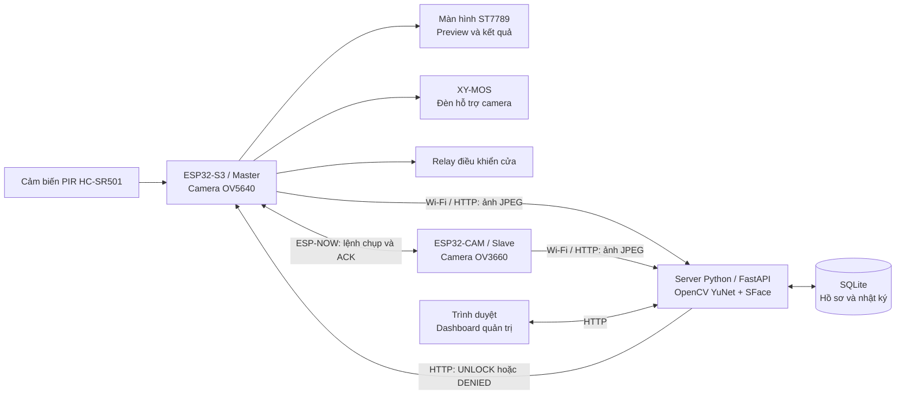

# ESP32-S3 Smart Home Face Recognition

**Hệ thống kiểm soát ra vào bằng nhận diện khuôn mặt với ESP32-S3, ESP32-CAM và server Python.**

Dự án kết hợp firmware nhúng, giao tiếp không dây và thị giác máy tính để thực hiện một luồng hoàn chỉnh: phát hiện chuyển động → chụp ảnh từ hai góc → xác thực khuôn mặt → điều khiển relay → lưu kết quả trên dashboard.

ESP32-S3 là bộ điều khiển chính, ESP32-CAM bổ sung góc chụp thứ hai. Việc phát hiện và đối chiếu khuôn mặt chạy trên **server Python**, còn các bo ESP32 đảm nhiệm thu ảnh, giao tiếp và điều khiển phần cứng.

[Kiến trúc](#kiến-trúc-hệ-thống) · [Chức năng](#chức-năng-chính) · [Công nghệ](#công-nghệ-sử-dụng) · [Cách chạy](#hướng-dẫn-chạy) · [Kiểm thử](#kiểm-thử)

## Mục tiêu dự án

- Xây dựng mô hình kiểm soát cửa bằng khuôn mặt, có màn hình hướng dẫn tại thiết bị và giao diện quản trị trên trình duyệt.
- Kết hợp hai camera để bổ sung góc quan sát; Master vẫn có thể xác thực khi Slave không tham gia phiên chụp.
- Tách firmware, xử lý nhận diện và quản lý dữ liệu thành các phần có thể kiểm thử, theo dõi và mở rộng độc lập.

## Kiến trúc hệ thống



ESP-NOW truyền lệnh điều khiển và trạng thái giữa hai bo. Ảnh được từng bo gửi trực tiếp lên server qua Wi-Fi/HTTP. Master là thiết bị duy nhất điều khiển relay.

### Vai trò các thành phần

| Thành phần | Chức năng |
| --- | --- |
| **ESP32-S3 Master** | Đọc PIR, hiển thị preview và đếm ngược trên ST7789, điều khiển đèn qua XY-MOS, tạo phiên chụp, gửi lệnh cho Slave, tải ảnh lên server và điều khiển relay theo kết quả. |
| **ESP32-CAM Slave** | Nhận lệnh ESP-NOW, phản hồi trạng thái camera, chụp ảnh OV3660 và gửi ảnh kèm cùng mã phiên lên server. Có xử lý thử lại khởi tạo camera và phương án chuyển sang JPEG bằng phần mềm. |
| **Server Python** | Phát hiện khuôn mặt bằng YuNet, trích xuất đặc trưng bằng SFace, kiểm tra chất lượng ảnh, đối chiếu nhiều mẫu và tổng hợp kết quả theo phiên. |
| **Dashboard** | Đăng nhập quản trị, quản lý người dùng và ảnh mẫu, xem kết quả nhận diện, ảnh của phiên và nhật ký kết nối thiết bị. |

## Chức năng chính

- **Luồng nhận diện tại cửa:** PIR kích hoạt màn hình, preview đếm ngược 20 giây; đèn hỗ trợ bật trong 5 giây cuối trước khi chụp.
- **Xác thực nhiều khung hình:** mỗi camera chụp tối đa 3 ảnh; cấu hình hiện tại yêu cầu ít nhất 2 ảnh đạt và nhất quán về cùng một người trong một camera.
- **Ưu tiên Master:** firmware sử dụng chế độ `master_primary`. Master xác thực đạt có thể hoàn tất phiên mà không chờ Slave; Slave có thể cung cấp kết quả dự phòng nếu Master không đạt hoặc không chụp được, trong giới hạn thời gian của phiên.
- **Điều khiển relay có kiểm tra phiên:** chỉ mở khi có kết quả cuối hợp lệ; mã phiên giúp bỏ qua phản hồi cũ và tránh kích hoạt lặp cho cùng phiên. Relay được kích hoạt trong khoảng 3 giây.
- **Quản lý mẫu khuôn mặt:** đăng ký ảnh chính diện, nghiêng nhẹ, có và không có khẩu trang; tối đa 20 mẫu mỗi hồ sơ theo cấu hình hiện tại.
- **Theo dõi hệ thống:** heartbeat chạy ở task riêng; dashboard cập nhật dữ liệu mỗi 3 giây, hiển thị trạng thái kết nối và nhật ký nhận diện.
- **Quản trị có xác thực:** mật khẩu được băm bằng PBKDF2-HMAC-SHA256, sử dụng session đăng nhập và CSRF token cho các thao tác quản lý người dùng.

Các kiểm tra chất lượng ảnh gồm kích thước khuôn mặt, độ sáng, độ nét và góc chụp. HOG vùng mắt hiện được dùng để chẩn đoán bổ sung, không tự quyết định cấp quyền.

## Công nghệ sử dụng

| Nhóm | Công nghệ |
| --- | --- |
| Firmware | C, ESP-IDF 5.5, FreeRTOS, GPIO, SPI, PSRAM |
| Giao tiếp | ESP-NOW, Wi-Fi 2.4 GHz, HTTP, JSON |
| Camera và hiển thị | `esp32-camera`, JPEG, OV5640, OV3660, ST7789 240 × 240 |
| Backend | Python 3.11, FastAPI, Uvicorn |
| Thị giác máy tính | OpenCV, YuNet, SFace, NumPy, model ONNX |
| Giao diện | Jinja2, HTML, CSS, JavaScript |
| Dữ liệu và kiểm thử | SQLite, Python `unittest`, kiểm thử trình duyệt bằng Chrome headless |

## Cấu trúc mã nguồn

```text
.
├── master_esp32s3/           # Firmware Master: camera, TFT, PIR, relay, đèn
├── slave_esp32cam/           # Firmware Slave: camera và ESP-NOW
├── cloud_server/
│   ├── app.py               # API, phiên chụp và dashboard
│   ├── face_ai.py           # YuNet/SFace và kiểm tra chất lượng ảnh
│   ├── recognition.py       # Đối chiếu danh tính, tổng hợp nhiều khung hình
│   ├── db.py                # Khởi tạo và cập nhật cấu trúc SQLite
│   ├── models/              # Hai model ONNX dùng cho nhận diện
│   ├── templates/           # Trang đăng nhập và dashboard
│   ├── static/              # CSS và JavaScript
│   ├── tests/               # Kiểm thử API, nhận diện và giao diện
│   └── .env.example         # Mẫu cấu hình server
├── project_network.h        # Cấu hình mạng chung và giá trị mẫu
├── camera_quality.h         # Thông số camera dùng chung
├── capture_protocol.h       # Giao thức điều khiển ESP-NOW dùng chung
└── tools/                   # Công cụ ghi log UART của Master
```

## Hướng dẫn chạy

### 1. Chuẩn bị

- ESP32-S3 với camera OV5640, màn hình ST7789, PIR HC-SR501, relay và cụm đèn qua XY-MOS. Cấu hình Master hiện tại dùng flash 16 MB và PSRAM Octal 8 MB.
- ESP32-CAM có PSRAM, sử dụng camera OV3660 và sơ đồ chân AI-Thinker như trong firmware. Cấu hình flash hiện tại là 4 MB.
- Máy tính chạy server Python 3.11 và môi trường ESP-IDF 5.5 để build/nạp firmware.
- Hai bo kết nối cùng mạng Wi-Fi 2.4 GHz; server có địa chỉ LAN mà cả hai bo truy cập được qua cổng 8000.

Các chân camera, TFT, PIR, relay và XY-MOS được khai báo trong [firmware Master](master_esp32s3/main/main.c), [driver ST7789](master_esp32s3/main/display_st7789.h), [driver đèn](master_esp32s3/main/camera_light.h) và [firmware Slave](slave_esp32cam/main/main.c). Kiểm tra các chân này theo bo thực tế trước khi nạp.

Các lệnh dưới đây dùng **PowerShell trên Windows**.

```powershell
git clone https://github.com/hoducduy243-create/ESP32-S3-Smart-Home-Face-Recognition.git
cd ESP32-S3-Smart-Home-Face-Recognition
```

### 2. Cấu hình và chạy server

Từ thư mục gốc của dự án:

```powershell
cd cloud_server
python -m venv .venv
.\.venv\Scripts\python.exe -m pip install -r requirements.txt
Copy-Item .env.example .env
```

Tạo mật khẩu băm và khóa session bằng hai lệnh sau:

```powershell
.\.venv\Scripts\python.exe -c "from getpass import getpass; from security import hash_password; print(hash_password(getpass('Admin password: ')))"
.\.venv\Scripts\python.exe -c "import secrets; print(secrets.token_hex(32))"
```

Điền kết quả vào `cloud_server/.env`:

```dotenv
ADMIN_USERNAME=admin
ADMIN_PASSWORD_HASH=<kết quả lệnh băm mật khẩu>
SESSION_SECRET_KEY=<kết quả lệnh tạo khóa session>
```

Trước khi đăng ký người dùng trên database mới, đặt `identity_aliases` thành `{}` trong [recognition_config.json](cloud_server/recognition_config.json). Mapping này sử dụng ID hồ sơ cụ thể, chỉ cần khi đã xác nhận hai hồ sơ thuộc cùng một người.

```powershell
.\.venv\Scripts\python.exe app.py
```

- Mở dashboard tại `http://localhost:8000` và đăng nhập bằng tài khoản vừa cấu hình.
- Kiểm tra server qua `http://localhost:8000/health`; xem API tại `http://localhost:8000/docs`.
- Server lắng nghe tại `0.0.0.0:8000`, tự khởi tạo database và các thư mục dữ liệu. Hai model ONNX cần thiết đã nằm trong `cloud_server/models/`.

### 3. Cấu hình mạng cho hai bo

Tạo tệp **`project_network.local.h` tại thư mục gốc** của dự án:

```c
#pragma once

#define WIFI_SSID "YOUR_2_4_GHZ_WIFI"
#define WIFI_PASS "YOUR_WIFI_PASSWORD"
#define PROJECT_SERVER_HOST "192.168.1.100"
#define PROJECT_SERVER_PORT 8000
```

Thay thông tin Wi-Fi và IP ví dụ bằng thông tin thực tế. `PROJECT_SERVER_HOST` là **IPv4 LAN của máy chạy server**, không dùng `localhost`, không thêm `http://`. Hai firmware cùng đọc cấu hình này qua `project_network.h`; cần build/nạp lại sau khi thay đổi.

Giữ hai bo trên cùng kênh Wi-Fi để ESP-NOW liên lạc được. Cho phép kết nối từ mạng LAN tới cổng 8000 trên máy chạy server.

### 4. Build và nạp firmware

Mở **terminal đã nạp môi trường ESP-IDF 5.5** tại thư mục gốc. Thay `COM3` và `COM4` bằng cổng thực tế của từng bo.

**Master ESP32-S3:**

```powershell
cd master_esp32s3
idf.py set-target esp32s3
idf.py build
idf.py -p COM3 flash monitor
```

**Slave ESP32-CAM:** mở một terminal ESP-IDF khác tại thư mục gốc:

```powershell
cd slave_esp32cam
idf.py set-target esp32
idf.py build
idf.py -p COM4 flash monitor
```

Với ESP32-CAM dùng USB-UART, nối GPIO0 với GND khi vào chế độ nạp; bỏ nối này và reset bo để chạy ứng dụng sau khi nạp xong. ESP-IDF Component Manager tải các thư viện camera/JPEG theo manifest và lockfile khi build.

### 5. Chạy thử luồng hoàn chỉnh

1. Khởi động server và hai bo; kiểm tra heartbeat trên dashboard.
2. Thêm người dùng cùng ảnh khuôn mặt rõ nét; có thể bổ sung ảnh nghiêng nhẹ và ảnh có khẩu trang của cùng người.
3. Kích hoạt PIR, đặt khuôn mặt trong vùng preview trên màn hình Master và chờ đếm ngược.
4. Hai camera gửi ảnh với cùng mã phiên; server kiểm tra chất lượng và đối chiếu danh tính.
5. Master hiển thị kết quả và kích hoạt relay khi được cấp quyền. Xem ảnh, điểm tương đồng và kết quả tại mục **Nhật ký nhận diện** trên dashboard.

## Kiểm thử

Từ thư mục `cloud_server`, sau khi đã cài dependencies:

```powershell
.\.venv\Scripts\python.exe -B -m unittest discover -s tests -v
```

Bộ kiểm thử hiện có **62 test**, bao gồm API quản lý người dùng, session/CSRF, chất lượng ảnh, đối chiếu danh tính, nhiều khung hình, timeout, upload lặp và các trường hợp Master/Slave mất ảnh hoặc phản hồi chậm. Các bài kiểm thử sử dụng database tạm và dữ liệu kiểm thử riêng.

Kiểm thử thao tác bổ sung ảnh trên giao diện, nếu máy đã cài Chrome ở đường dẫn mặc định:

```powershell
.\.venv\Scripts\python.exe -B tests/browser_samples.py
```

## Cấu hình và phạm vi

- Ngưỡng chất lượng, độ tương đồng, số mẫu và timeout nằm trong [recognition_config.json](cloud_server/recognition_config.json). Điểm tương đồng là cosine similarity, không phải phần trăm xác suất nhận diện đúng.
- `project_network.local.h`, `.env`, database, ảnh người dùng và ảnh chụp được giữ ở môi trường chạy, đã được loại khỏi Git. Khi clone mới cần tự cấu hình và đăng ký người dùng.
- Dự án là mô hình thử nghiệm trong mạng LAN. Bộ kiểm thử xác nhận logic phần mềm; độ chính xác trong điều kiện ánh sáng, góc chụp và khẩu trang thực tế cần được đánh giá trên dữ liệu riêng. Chưa triển khai cơ chế kiểm tra người thật/chống giả mạo khuôn mặt.
